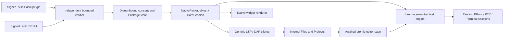

# sui-code native product architecture — 0.4.0

This branch continues `fa44a36efad247c153a7c831125e3de88b60634c`; it does not change upstream or main. Its application identity remains `dev.suicode.ide.debug`. The final APK certificate must be compared with the preserved v0.1 artifact before an upgrade is claimed compatible.

## Boundaries

Core contains the editor/file/session primitives, independent package verifier, permissions, recipe interpreter, debugger dataflow interpreter, project template publisher and design tokens. Language-specific scripts, standards, environment declarations, project organization, servers and debug launch plans live in `native-library/src/`. C and C++ share one package pair and one visible environment toolchain. Existing configured ProjectRunner runs and export infrastructure are retained; new Kit workflows use the shared native task engine.

The new ecosystem uses no JCode plugin interface, archive, market, downloader, execution host or lifecycle. Legacy implementation sources and original license notices remain in the repository; the application no longer discovers them, loads their providers, imports `.jext/.vsix`, queries their markets or executes them as native packages. The old plugin disk directories are not erased.

## Installed state and recovery

Packages are stored only in the app-private `sui-code/native-packages` directory, separately from Ubuntu, Internal Files, project records, settings and old plugins. Stored archives are addressed by SHA-256; state publication uses fsync and atomic rename. Disabled or removed Kits cannot execute new operations. Disabling a dependency revokes dependent active services, and re-enabling reconciles eligible registrations. Removing an installed dependency is refused. A bad package must not reset the rootfs or other packages.

Install/update review shows the exact digest, signature, source, size, compatibility, dependencies, permissions and declared execution behavior. Unknown publishers require explicit trust. Existing signer identity cannot silently change on update. Previous archives remain available for reviewed rollback. Component removal never runs an uninstall script and never removes a language runtime or user project.

## Execution and IDE services

The active editor's real path is captured; saving must finish successfully before mapping or process creation. Source rules come from enabled Basic packages, including case-sensitive `.C`. Proper argv quoting preserves Unicode, whitespace, quotes and shell metacharacters. A safe bind ancestor handles colon-containing paths. All four languages use one busy/repeat gate, one owned terminal task lifecycle and the original PTY for interactive input. Stop, terminal close and payload completion clean the task namespace while leaving unrelated processes alone.

LSP entries and DAP launch workflows come from enabled authorized Kits. LSP edits require write consent and actual application before acknowledgement. Stale formatting edits are discarded. Kit debug preparation is cancellable and owned; a disabled Kit cannot launch a delayed prepared session. Server and adapter transports carry process instance ownership for teardown. Java uses genuine JDT LS/Java Debug RPC preparation; C/C++ uses clangd/LLDB, Python uses pylsp/debugpy. PRoot ptrace behavior must still be tested on the target tablet. DAP currently uses internalConsole; QuickRun provides interactive stdin through the PTY.

Projects use authenticated Kit templates, standard Maven/JUnit, CMake/Ninja/CTest and Python unittest. Template creation preflights collisions and never overwrites existing targets; rollback preserves concurrent edits. Internal Files remains usable without any Project or Workspace. Existing project creation/import/export paths remain available.

## Environments and design

The verified v0.1 Java path and java.env are retained. Java GA lookup resolves a reviewed immutable official archive; installation verifies checksum and java/javac/jshell/HelloWorld before activation. Native manager inventory can select a verified owned JDK and remove only an inactive unused managed installation. C/C++ is a signed Ubuntu combined toolchain. Python's official CPython feed supplies the newest stable upstream version; the install/update channel explicitly shows Ubuntu's supported signed package version rather than pretending it is the newest upstream interpreter. Package updates are separately reviewed and preserve custom tool selections. APT cancellation waits for safe boundaries.

The Android native design consumes the same public Light/Dark tokens as the UI specification. It uses an independent launcher mark, fixed semantic icon vocabulary, 4/8dp corners, native typography and touch targets. Files/Run/language/plugin/Kit/package/settings navigation is visible in a two-column tool area; native management pages use the full editor region. Persistent file navigation reserves space instead of covering the editor. A measured bottom terminal split responds to available window dimensions and can be resized through a drag handle or accessible settings slider. Existing preferences remain stored; old theme IDs safely resolve to the new native theme.

## Verification limits

Protocol, storage, quoting, filesystem failure recovery and state algorithms have JVM tests. Real Ubuntu x64 tests execute all languages, three multi-file projects, official Java tools, LSP editing services, and three debug adapters with real breakpoints and variables. They do not prove Android ARM64, physical keyboard dispatch, IME, TalkBack, tablet orientation or upgrade installation. The final report must list those as hardware acceptance checks, alongside actual APK metadata, certificate and artifact round-trip evidence.
